# Alnazeer Portfolio — Architecture & Code Diagrams

> A complete visual guide to the code in this repository: the static marketing site, the AI assistant client, the Cloudflare Worker proxy, the Google Apps Script backend, the Google Sheet data model, and the owner dashboard.

**How to read this document**

- Every diagram is [Mermaid](https://mermaid.js.org/) and renders automatically on GitHub.
- For a local, clickable gallery open **`architecture-diagrams.html`** in a browser.
- File names, function names, and constants are written exactly as they appear in the code.
- Arabic strings are kept as-is because they are part of the actual data contracts.

---

## Contents

1. [One-minute mental model](#1-one-minute-mental-model)
2. [System context](#2-system-context)
3. [Deployment and hosting topology](#3-deployment-and-hosting-topology)
4. [Repository map](#4-repository-map)
5. [Public site map and navigation graph](#5-public-site-map-and-navigation-graph)
6. [Frontend runtime architecture (`script.js`)](#6-frontend-runtime-architecture-scriptjs)
7. [Chat popup state machine](#7-chat-popup-state-machine)
8. [Website booking form flow](#8-website-booking-form-flow)
9. [AI assistant end-to-end sequence](#9-ai-assistant-end-to-end-sequence)
10. [Cloudflare Worker request pipeline](#10-cloudflare-worker-request-pipeline)
11. [Model discovery and fallback state machine](#11-model-discovery-and-fallback-state-machine)
12. [In-chat booking flow](#12-in-chat-booking-flow)
13. [Google Apps Script backend map](#13-google-apps-script-backend-map)
14. [Apps Script `doPost` routing](#14-apps-script-dopost-routing)
15. [Dashboard authentication and refresh sequence](#15-dashboard-authentication-and-refresh-sequence)
16. [Data model and Google Sheet schema](#16-data-model-and-google-sheet-schema)
17. [Chat session grouping algorithm](#17-chat-session-grouping-algorithm)
18. [Dashboard UI component map](#18-dashboard-ui-component-map)
19. [Dashboard state machine](#19-dashboard-state-machine)
20. [Security layers and trust boundaries](#20-security-layers-and-trust-boundaries)
21. [State and storage lifecycle](#21-state-and-storage-lifecycle)
22. [Failure modes and fallbacks](#22-failure-modes-and-fallbacks)
23. [Key configuration constants](#23-key-configuration-constants)
24. [Notable behaviors, gaps, and gotchas](#24-notable-behaviors-gaps-and-gotchas)
25. [Suggested reading paths](#25-suggested-reading-paths)

---

## 1. One-minute mental model

This project is **not one application**. It is four cooperating pieces:

| Layer | Technology | Responsibility |
|---|---|---|
| Public website | Static HTML + one `styles.css` + one `script.js` | Marketing pages, booking form, AI chat widget, WhatsApp CTAs |
| AI proxy | Cloudflare Worker (`worker/worker.js`) | Validates requests, rate-limits, calls Groq, formats the answer, writes logs |
| Backend | Google Apps Script (`appscript/Code.gs`) | Receives bookings/contacts/chat logs, writes Google Sheets, sends email, serves dashboard |
| Owner dashboard | Apps Script HTML (`appscript/Index.html`) | PIN-protected read-only view of appointments, chats, contacts, charts |

The two write paths are:

1. **Website form** → Apps Script `doPost` → `استشارات` sheet + email.
2. **AI chat** → Cloudflare Worker → Groq; Worker → Apps Script `doPost` → `محادثات AI` sheet; optional in-chat booking → `استشارات` sheet + email.

The dashboard reads all three sheets through `getDashboardDataSecure(pin)`.

---

## 2. System context

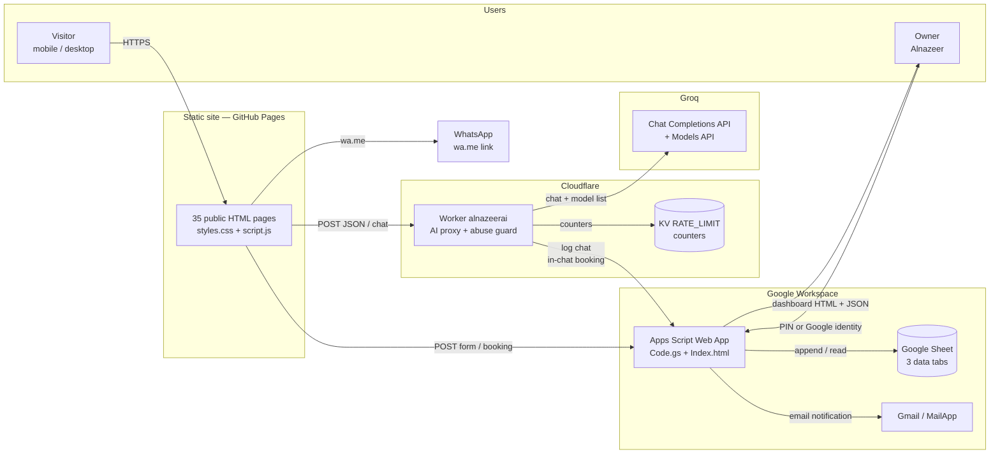

**Trust boundaries**

- The browser is untrusted: every message, session ID, page name, and digest is attacker-controlled.
- The Worker is the only component that holds the Groq API key.
- Apps Script is reachable directly by anyone who knows the `/exec` URL; the website booking form uses that URL.
- Google Sheets and Gmail are the durable system of record.
- The dashboard is a separate Apps Script web app; it is not part of the static site.

---

## 3. Deployment and hosting topology

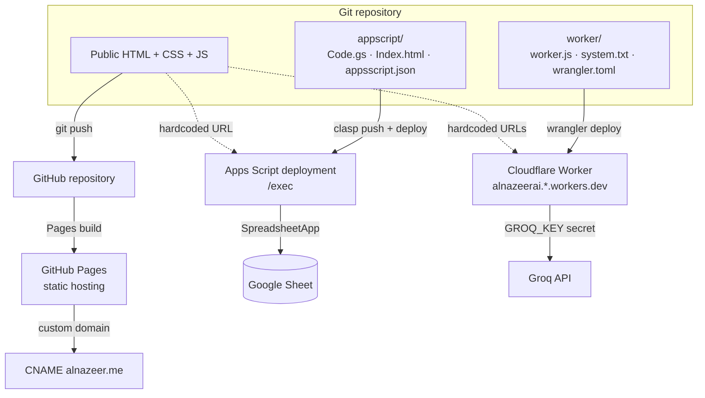

| Target | Source | Deploy command / mechanism |
|---|---|---|
| `alnazeer.me` | root HTML/CSS/JS + `images/` | GitHub Pages from the repository |
| `alnazeerai.alnzyrbdalmnm90.workers.dev` | `worker/` | `cd worker && npx wrangler deploy` |
| Apps Script `/exec` | `appscript/` | `clasp push` then deploy the web app |
| Google Sheet | `SHEET_ID` in `Code.gs` | Created/opened at runtime |

**Deployment coupling:** `script.js` hardcodes the Worker URL and the Apps Script URL; `worker/worker.js` hardcodes the same Apps Script URL; `worker/wrangler.toml` hardcodes the Worker name and KV namespace. Changing a deployment target requires editing multiple files.

---

## 4. Repository map

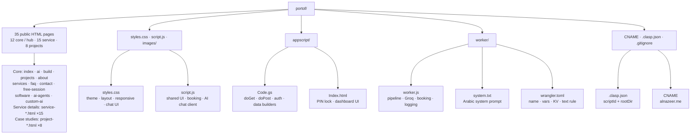

| Path | What it is | Key details |
|---|---|---|
| `index.html` | Home page | Hero, services, stats counters, free-session CTA, projects preview, about, FAQ preview, contact CTA |
| `ai.html`, `build.html` | Two top-level service narratives | Each has 3 service cards and 3 project previews |
| `services.html` | Service chooser | Links only to `ai.html` and `build.html` |
| `ai-agents.html`, `custom-ai.html`, `software.html` | Service hub pages | Intended parents of the 15 `service-*.html` pages |
| `service-*.html` | 15 service detail pages | Each has breadcrumb back to its hub, FAQ, CTA |
| `project-*.html` | 8 case studies | Mudif, Almadar, Sijil Pro, Spectra Baby, Adyar, Asas Makeen, Shurfat, Rulva |
| `free-session.html` | Booking page | `#bookingForm` with 6 fields |
| `contact.html` | Contact options | WhatsApp, free session, email; no contact form |
| `faq.html`, `about.html`, `projects.html` | Content pages | Shared nav/footer/chat widget |
| `styles.css` | Single global stylesheet | CSS variables, layout, cards, forms, chat, responsive, RTL |
| `script.js` | Single global script | One IIFE shared by every page |
| `appscript/Code.gs` | Apps Script backend | `doGet`, `doPost`, auth, sheet helpers, data builders |
| `appscript/Index.html` | Dashboard | Embedded CSS + JS, PIN lock, 4 tabs |
| `worker/worker.js` | Cloudflare Worker | CORS, limits, Groq call, booking template, logging |
| `worker/system.txt` | System prompt | Imported as a text module by Wrangler |
| `worker/wrangler.toml` | Worker config | Name, `ALLOWED_ORIGINS`, KV binding, text rule |
| `proposed-chat-fix.md` / `.patch` | Historical fix | Formatting/typewriter fix; already applied |

---

## 5. Public site map and navigation graph

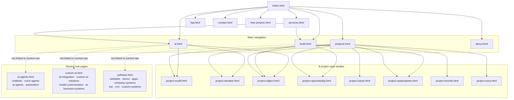

**Navigation facts**

- The header nav is identical on every public page: Home, AI, Software, Projects, About.
- The primary CTA on every page is `free-session.html`.
- Footer columns repeat: Pages, Services, Contact.
- The 15 service pages are reachable only through the three hub pages, and those hubs are currently not linked from `ai.html` / `build.html` / `services.html`. This is a navigation/SEO gap worth fixing (see §24).
- The chat widget is injected on every public page: `#chatPop`, `#chatFab`, `#aiLog`, `#aiForm`, `#aiChips`, plus the WhatsApp FAB and back-to-top button.

---

## 6. Frontend runtime architecture (`script.js`)

`script.js` is a single IIFE (`(function () { 'use strict'; ... })()`) loaded with `defer` on every page. It has no framework, no bundler, and no module imports.

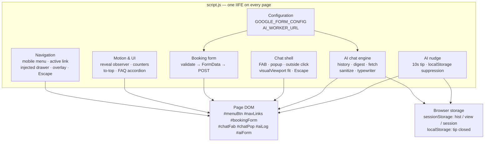

| Module | Trigger | What it does | Main DOM hooks |
|---|---|---|---|
| Config | Script load | Holds Apps Script URL and field names; `enabled: true` | — |
| Mobile menu | `#menuBtn` click | Toggles `.open` on `#navLinks`, syncs `aria-expanded` | `#menuBtn`, `#navLinks` |
| Active nav | Load | Matches `location.pathname` to nav hrefs, adds `.active` | `.nav-links a` |
| Reveal on scroll | `IntersectionObserver` | Adds `.visible` to `.reveal`; staggers by 90ms; respects `prefers-reduced-motion` | `.reveal` |
| Counters | `IntersectionObserver` at 50% | Animates `[data-count]` with cubic ease-out over 1100ms | `[data-count]` |
| To-top | Scroll > 600px | Shows `#toTop`; smooth scroll to top | `#toTop` |
| FAQ | `.faq-q` click | One-open-at-a-time accordion; sets `maxHeight` and `aria-expanded` | `.faq-item`, `.faq-q`, `.faq-a` |
| Booking form | `#bookingForm` submit | Validates, sends `FormData` to Apps Script, shows success panel | `#fullName`, `#phone`, `#email`, `#workType`, `#problem`, `#workSize`, `#bookingNote`, `#bookingSuccess`, `#bookAgain` |
| Drawer helpers | Script load | Injects overlay, logo header, close button, CTA into mobile drawer | `#navLinks`, `.nav-overlay`, `.drawer-head`, `.drawer-close`, `.drawer-cta` |
| Chat shell | `#chatFab` click | Opens/closes popup; outside click and Escape close it | `#chatFab`, `#chatPop` |
| Visual viewport fit | `visualViewport` resize/scroll | Sets `--vvp-top` and `--vvp-h` so the popup stays above the mobile keyboard | `#chatPop` |
| AI chat | Form submit / chip click | Sends message to Worker, streams typing effect, stores history | `#aiLog`, `#aiForm`, `#aiText`, `#aiChips` |
| AI nudge | 10s timer | Shows tip if chat closed and not recently dismissed; hides after 12s | `.ai-tip`, `#chatFab` |

**Key client-side data structures**

```js
// sessionStorage keys
alnazeer_chat_hist   // [{ role: "user"|"assistant", content: string }] last 40
alnazeer_chat_view   // [{ c: "u"|"a", t: string }] last 40 bubbles
alnazeer_chat_session// "c-<base36 timestamp>-<4 random chars>" per tab

// localStorage key
alnazeer_ai_tip_closed // timestamp of last nudge dismissal
```

**Message pipeline (client)**

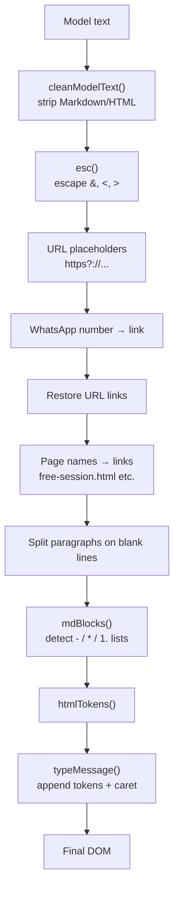

This pipeline is deliberately defensive: the model is instructed to output plain text, but it occasionally emits Markdown or raw HTML. The client strips/normalizes it before rendering, then linkifies only known URL/page patterns. `esc()` runs before linkification, so `<script>` stays inert text.

---

## 7. Chat popup state machine

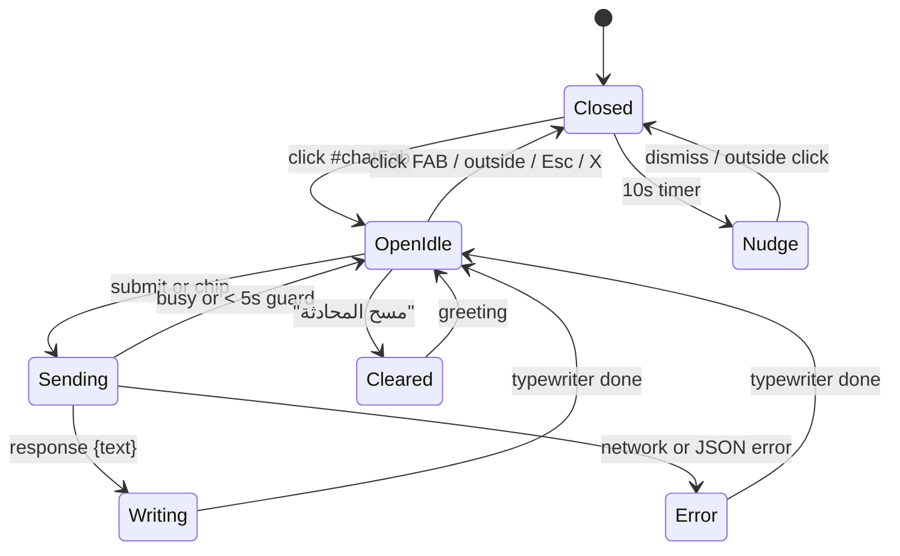

**Behavior details**

- `greet()` runs on load and on FAB click. If `alnazeer_chat_view` has prior bubbles, it restores them instead of showing the welcome message.
- `send()` adds the user bubble immediately, then checks `busy` and a 5000ms cooldown. If blocked, it shows `مهلاً قليلاً…` without calling the Worker.
- While waiting, a bot bubble contains animated dots (`DOTS_HTML`).
- `typeMessage()` types at ~55 chars/sec, accelerating after 4s and 8s; with `prefers-reduced-motion` the answer appears instantly.
- The input is not disabled; the `busy` flag and cooldown prevent overlapping requests.
- Clearing the chat removes both storage keys, clears the log, re-shows chips, and adds a fresh greeting.
- The nudge is suppressed for 120s after dismissal and is stored in `localStorage`, so it survives reloads.

---

## 8. Website booking form flow

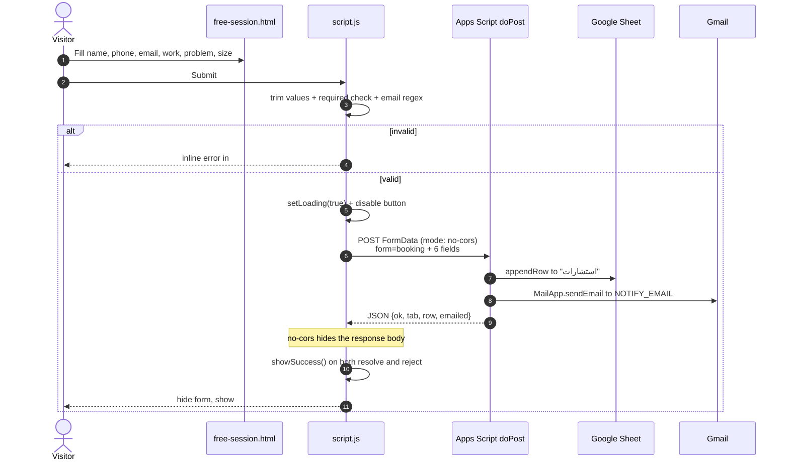

**Field contract**

| Form field | `FormData` key | Sheet column |
|---|---|---|
| `#fullName` | `name` | الاسم |
| `#phone` | `phone` | الجوال |
| `#email` (optional) | `email` | الإيميل |
| `#workType` | `work` | العمل |
| `#problem` | `problem` | المشكلة |
| `#workSize` | `size` | الحجم |
| — | `form=booking` | Selects the booking branch in `doPost` |

**Important behavior:** because `fetch` uses `mode: 'no-cors'`, the browser cannot read the Apps Script response. The code calls `showSuccess()` in both `.then()` and `.catch()`, so a server-side failure is indistinguishable from success in the UI. The only real failure signal would be a network-level rejection, which is also treated as success. This is intentional to avoid CORS friction, but it means the success panel is optimistic, not confirmed.

---

## 9. AI assistant end-to-end sequence

```mermaid
sequenceDiagram
  autonumber
  actor U as Visitor
  participant B as Browser script.js
  participant W as Cloudflare Worker
  participant KV as KV RATE_LIMIT
  participant G as Groq API
  participant AS as Apps Script
  participant SH as Google Sheet

  U->>B: Open chat and send a question
  B->>B: Add user bubble; push to hist; save sessionStorage
  B->>B: recent = last 16 messages; digest = older summary
  B->>W: POST {messages, session, page, digest}

  W->>W: CORS + POST check + 20KB cap
  W->>W: sanitizeMessages: roles, last 16, 500 chars
  W->>KV: bump m:IP, d:IP:day, s:session:day

  alt over limit
    KV-->>W: count > threshold
    W-->>B: 429 {text: BUSY_MSG}
  else allowed
    W->>W: Turnstile check if TURNSTILE_SECRET is set
    W->>W: INJECTION regex on last user message
    W->>W: model discovery once per isolate
    W->>W: ANSWER_CACHE lookup

    alt cache hit under 10 minutes
      W-->>B: {text: cached answer}
    else cache miss
      W->>G: POST /openai/v1/chat/completions (model 1)
      alt success
        G-->>W: content
      else error / empty / finish_reason=length
        W->>G: retry model 2, then model 3
        G-->>W: content or error
      end

      opt answer contains [[حجز]]...[[/حجز]]
        W->>AS: POST form=booking (8s timeout)
        AS->>SH: appendRow to "استشارات"
        AS->>AS: MailApp.sendEmail
        AS-->>W: {ok, tab, row}
        W->>W: replace answer with confirmation text
      end

      W->>W: cache answer if not fallback and not booked
    end

    W-->>B: {text}
    W-)AS: ctx.waitUntil(log=chat)
    AS->>SH: appendRow to "محادثات AI"
  end

  B->>B: push assistant message; save history
  B->>B: typewriter render with links
  B-->>U: answer / booking confirmation
```

**What the browser sends**

```json
{
  "messages": [
    { "role": "user", "content": "..." },
    { "role": "assistant", "content": "..." }
  ],
  "session": "c-m8x2k1-a9f3",
  "page": "/free-session.html",
  "digest": "س: ...\nن: ..."
}
```

**What the Worker returns**

```json
{ "text": "..." }
```

The contract is intentionally tiny. The Worker always returns JSON with a `text` field, even on most errors, so the client can render a useful Arabic message.

---

## 10. Cloudflare Worker request pipeline

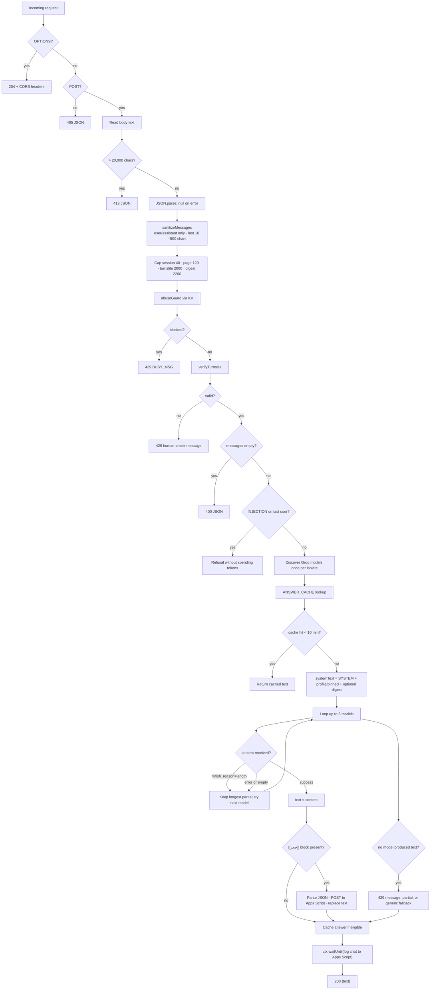

**Pipeline order matters**

1. CORS and method checks happen before reading the body.
2. Size cap happens before JSON parsing.
3. Sanitization happens before rate limiting so malformed payloads do not count as real messages.
4. Rate limiting happens before Turnstile and before any Groq call.
5. Injection filtering happens before model discovery/cache lookup, so obvious attacks cost zero tokens.
6. Cache lookup happens before building the system prompt and calling Groq.
7. In-chat booking happens after the model answers, before caching.
8. Chat logging is fire-and-forget via `ctx.waitUntil`.

**CORS behavior**

- `ALLOWED_ORIGINS` is a comma-separated list in `wrangler.toml`.
- Empty list → `Access-Control-Allow-Origin: *`.
- Non-empty list → exact host match, `www`/non-`www` equivalence, and `*.example.com` wildcards are supported.
- Missing or `null` Origin is allowed (curl, `file://`, same-origin), so CORS is a browser guard, not authentication.

**Rate limiting**

| Counter | Key | TTL | Limit |
|---|---|---|---|
| Per-minute IP | `m:<ip>` | 120s | 30/min |
| Per-day IP | `d:<ip>:<yyyymmdd>` | 90,000s (~25h) | 150/day |
| Per-day session | `s:<session>:<yyyymmdd>` | 90,000s (~25h) | 50/day |

KV failures are swallowed and fail open: a broken KV namespace does not block visitors.

---

## 11. Model discovery and fallback state machine

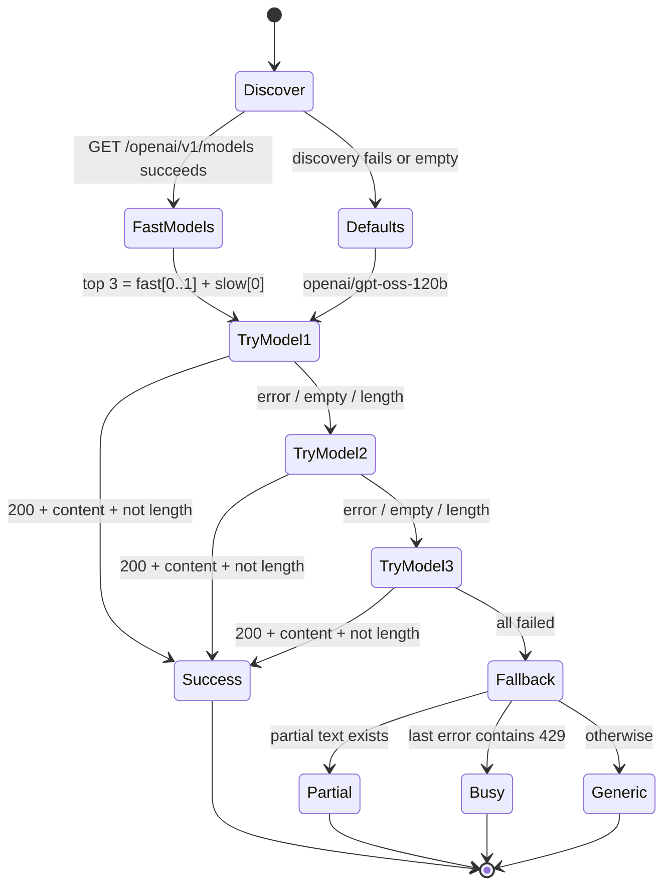

**Model selection logic**

- Discovery filters model IDs matching `llama|qwen|gpt-oss|kimi|deepseek|mistral` and excludes `guard|whisper|tts|embed|playground|moderation|vision|audio`.
- Models are ranked by a preference list: `gpt-oss-120b`, `gpt-oss-20b`, `qwen3.6-27b`, `qwen3.8-27b`, `qwen3.6`, `qwen3.8`, `kimi-k2`, `mistral-large`, `ministral`.
- "Fast" models (not matching `r1|distill|thinking|reason|gpt-oss|qwen3`) are sorted first; reasoning models are sorted after.
- `CHAT_MODELS` is cached in `globalThis` per Worker isolate. A new isolate rediscovers.
- The Worker tries at most the first 3 models. Every retry resends the full prompt and consumes Groq tokens.
- `gpt-oss` requests use `max_tokens: 700` and `reasoning_effort: 'low'`; other models use `max_tokens: 1500`.
- If a model stops with `finish_reason: 'length'`, its content is kept as `partial` and the next model is tried. If all fail, the longest partial is returned.
- If the last error contains `429`, the user gets the "assistant is busy" message with WhatsApp; otherwise the generic fallback or partial answer.

---

## 12. In-chat booking flow

The model can emit a machine-readable booking block. The Worker intercepts it, books the consultation, and hides the block from the user.

```mermaid
sequenceDiagram
  autonumber
  participant U as Visitor
  participant B as Browser
  participant W as Worker
  participant G as Groq
  participant AS as Apps Script
  participant SH as Google Sheet
  participant MAIL as Gmail

  U->>B: "أريد أحجز استشارة" + details
  B->>W: chat request
  W->>G: chat completion with SYSTEM
  G-->>W: text containing [[حجز]]{...}[[/حجز]]
  W->>W: regex match + JSON.parse
  alt name, contact, problem all present
    W->>AS: POST form=booking<br/>work="حجز عبر المساعد الذكي"
    AS->>SH: appendRow to "استشارات"
    AS->>MAIL: notify owner
    AS-->>W: {ok:true, tab, row}
    W->>W: remove booking block from text
    W-->>B: fixed confirmation + WhatsApp link
  else missing fields or invalid JSON
    W->>W: remove block; keep remaining text
    W-->>B: normal answer
  else Sheet call fails or times out
    W-->>B: technical-error message + WhatsApp link
  end
  B-->>U: confirmation or fallback
```

**Template contract**

```
[[حجز]]
{
  "الاسم": "...",
  "التواصل": "...",
  "المشكلة": "..."
}
[[/حجز]]
```

- Required keys: `الاسم`, `التواصل`, `المشكلة`.
- `التواصل` is split into email if it contains `@`; otherwise it is sent as `phone`.
- `work` is always set to `حجز عبر المساعد الذكي`, which is how the dashboard classifies the appointment as `source: "ai"`.
- The Sheet call has an 8-second `AbortController` timeout.
- The booking block is always removed from the visible answer, even if booking fails.
- Successful in-chat bookings are not cached, so the same request cannot accidentally reuse a confirmation.

---

## 13. Google Apps Script backend map

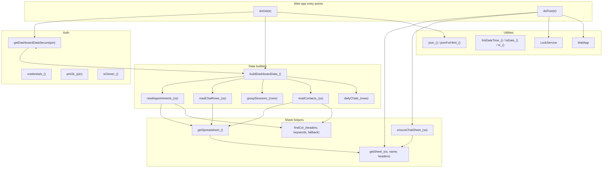

| Function | Visibility | Purpose |
|---|---|---|
| `doGet(e)` | Web app entry | Serves dashboard HTML or JSON API; checks PIN/owner |
| `doPost(e)` | Web app entry | Handles chat log, contact, and booking writes |
| `getDashboardDataSecure(pin)` | `google.script.run` API | Only intended client-callable data method; checks auth |
| `buildDashboardData_()` | Private | Reads all sheets and assembles stats/lists |
| `readAppointments_()` | Private | Normalizes `استشارات` rows, sorts newest first |
| `readChatRows_()` | Private | Normalizes `محادثات AI` rows |
| `groupSessions_()` | Private | Groups chat rows into conversations |
| `readContacts_()` | Private | Normalizes `تواصل` rows |
| `dailyChats_()` | Private | Counts chat rows per day for the last 7 days |
| `getSpreadsheet_()` | Private | `getActiveSpreadsheet()` or `openById(SHEET_ID)` |
| `getSheet_()` | Private | Gets or creates a sheet with headers |
| `ensureChatSheet_()` | Private | Migrates old chat sheet shape to the current headers |
| `credentials_()` | Private | Reads PIN/password from Script Properties with code fallbacks |
| `pinOk_()` | Private | Compares PIN or password |
| `isOwner_()` | Private | Compares active user email to `NOTIFY_EMAIL` |
| `json_()` | Private | JSON `ContentService` response |
| `jsonForHtml_()` | Private | Safe JSON for embedding in HTML |
| `fmtDateTime_()`, `toDate_()`, `tz_()` | Private | Date/time normalization in `Africa/Khartoum` |

**Privacy rule:** functions ending in `_` are private by Apps Script convention and are not callable from `google.script.run`. `getDashboardDataSecure` is the only public data API.

---

## 14. Apps Script `doPost` routing

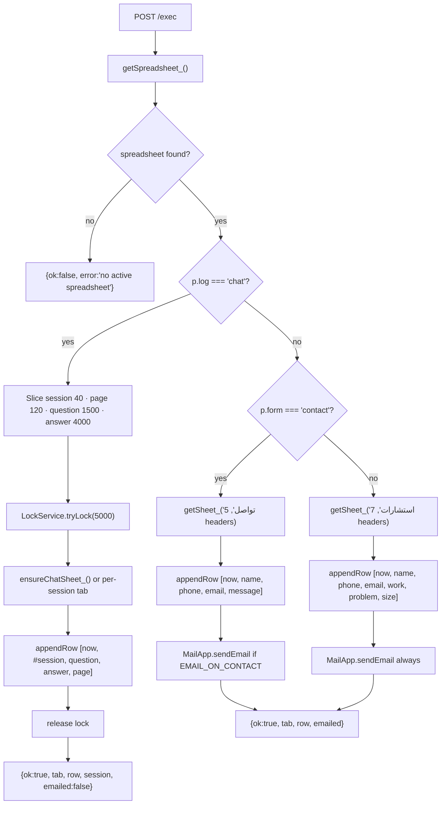

**Chat session label normalization**

```js
var label = String(p.session || '').trim().slice(0, 40);
if (label && label.charAt(0) !== '#') label = '#' + label.replace(/^c-/, '');
```

So a browser session `c-m8x2k1-a9f3` becomes `#m8x2k1-a9f3` in the sheet. This is the key used by `groupSessions_()`.

**Email behavior**

- Booking: always attempts `MailApp.sendEmail`.
- Contact: attempts only if `EMAIL_ON_CONTACT` is `true` (it is).
- Chat log: no email.
- If email fails, the row is still saved; the JSON returns `emailed: false` and logs the error.

**Sheet creation**

`getSheet_()` creates a missing tab and writes bold, frozen headers. `ensureChatSheet_()` checks the first row; if it does not match `CHAT_HEADERS`, it copies the old data to `محادثات AI (قديم)`, deletes the old tab, and creates a clean one. If migration fails, it returns the old sheet.

---

## 15. Dashboard authentication and refresh sequence

```mermaid
sequenceDiagram
  autonumber
  actor O as Owner
  participant B as Browser
  participant AS as Apps Script doGet
  participant AUTH as isOwner_ / pinOk_
  participant DB as buildDashboardData_
  participant SH as Google Sheet

  O->>B: Open /exec (optionally ?pin=...)
  B->>AS: GET
  AS->>AUTH: Check Session email or URL pin
  alt authorized
    AUTH-->>AS: true
    AS->>DB: buildDashboardData_()
    DB->>SH: Read "استشارات", "محادثات AI", "تواصل"
    SH-->>DB: rows
    DB-->>AS: stats + appointments + sessions + contacts
    AS-->>B: Index.html with bootData JSON + urlPin
    B->>B: boot() reads #bootData
    B-->>O: Dashboard unlocked
    Note over B: strip pin/key from URL with history.replaceState
    loop every 60s while tab visible
      B->>AS: google.script.run.getDashboardDataSecure(pin)
      AS->>DB: rebuild data
      DB-->>AS: data
      AS-->>B: data
      B->>B: renderAll()
    end
  else locked
    AUTH-->>AS: false
    AS-->>B: Index.html with {ok:false, locked:true}
    B-->>O: PIN lock screen
    O->>B: Enter PIN
    B->>AS: getDashboardDataSecure(pin)
    alt correct
      AS-->>B: data
      B->>B: showApp(); startAutoRefresh()
    else wrong
      AS-->>B: {ok:false, error}
      B-->>O: error message; input cleared
    end
  end
```

**Auth model**

- `isOwner_()` compares `Session.getActiveUser().getEmail()` to `NOTIFY_EMAIL`.
- `pinOk_()` accepts either the configured PIN or the configured password (case-insensitive for the password).
- Credentials come from Script Properties `DASHBOARD_PIN` / `DASHBOARD_PASSWORD`, with hardcoded fallbacks in `Code.gs`.
- `doGet` supports a JSON API: `?api=true&pin=...` or `?format=json&pin=...`.
- The dashboard URL can carry `?pin=...`; the server embeds it as `SERVER_PIN` so auto-refresh works, and the client strips it from the visible URL. It is still present in the page source by design.
- There is no server-side session cookie; every refresh sends the PIN again.

---

## 16. Data model and Google Sheet schema

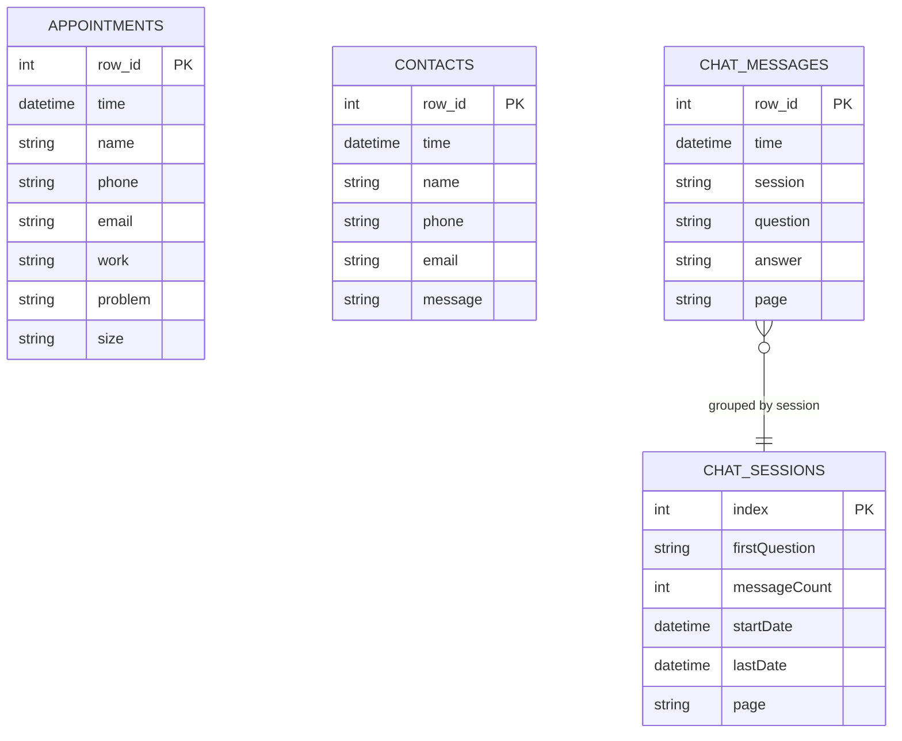

**Sheet tabs**

| Tab | Headers (Arabic) | Written by | Read by |
|---|---|---|---|
| `استشارات` | الوقت، الاسم، الجوال، الإيميل، العمل، المشكلة، الحجم | `doPost` booking branch; Worker in-chat booking | `readAppointments_()` |
| `تواصل` | الوقت، الاسم، الجوال، الإيميل، الرسالة | `doPost` contact branch | `readContacts_()` |
| `محادثات AI` | الوقت، المحادثة، السؤال، الرد، الصفحة | `doPost` chat-log branch | `readChatRows_()` |
| `محادثات AI (قديم)` | Old shape | Migration archive | Not read |

**Derived fields**

| Derived value | Rule |
|---|---|
| `source` | `"ai"` if `work` contains `المساعد الذكي` or `ذكاء`; otherwise `"web"` |
| `session` label | `#` + session ID without the `c-` prefix |
| `firstQuestion` | First non-empty question in the session |
| `messageCount` | Number of Q/A rows in the session |
| `startDate` / `lastDate` | Min/max timestamp in the session |
| `page` | Unique page names joined with `، ` |
| `dailyChats` | Count per day for the last 7 days in `Africa/Khartoum` |
| `sizeDistribution` | Count per `size` value, default `غير محدد` |

**Read caps**

- `MAX_APP_ROWS = 2000`
- `MAX_CHAT_ROWS = 3000`
- `MAX_CONTACT_ROWS = 1000`

These caps keep the dashboard response bounded. They are not pagination; older rows beyond the cap are simply not shown.

---

## 17. Chat session grouping algorithm

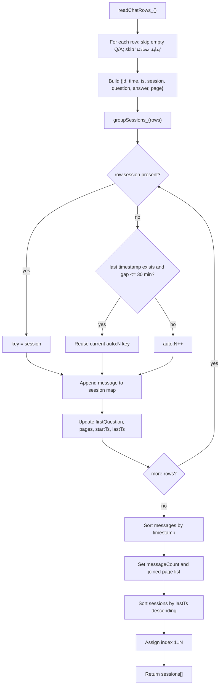

**Rules**

- Modern rows always have a session label, so they group exactly by conversation even if rows arrive interleaved.
- Legacy rows without a session label are grouped by a 30-minute inactivity gap (`SESSION_GAP_MINUTES = 30`).
- Rows whose question contains `بداية محادثة` are skipped (old separator rows).
- Sessions are sorted newest-first by last message.
- Messages inside a session are sorted oldest-first.
- The dashboard displays session `index` (1 = newest), not the raw session ID.

---

## 18. Dashboard UI component map

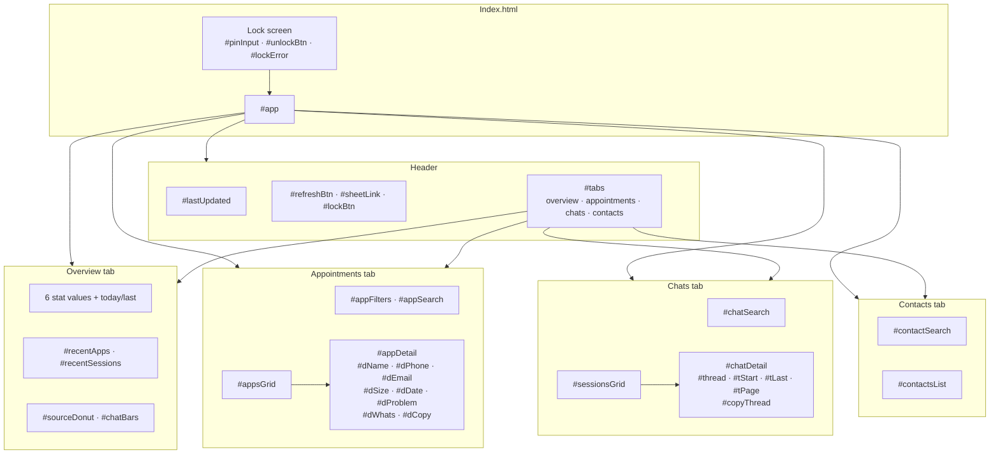

**Rendering functions**

| Function | Renders |
|---|---|
| `renderHeader()` | Last updated time, Google Sheet link |
| `renderStats()` | Total appointments, AI vs web, sessions, chats, contacts, today's messages, last activity |
| `renderOverview()` | Latest 5 appointments, latest 5 sessions |
| `renderCharts()` | Conic-gradient donut for AI vs web; 7-day bar chart |
| `renderAppointments()` | Filterable/searchable appointment cards |
| `openAppointment(id)` | Appointment detail view + WhatsApp link + copy summary |
| `renderSessions()` | Filterable/searchable conversation cards |
| `openSession(index)` | Full Q/A thread with timestamps and pages |
| `renderContacts()` | Contact messages with WhatsApp links |
| `renderAll()` | Calls all render functions |

**Event handling**

- Tabs use event delegation on `#tabs` with `data-tab`.
- `data-goto` switches tabs from overview links.
- `data-open-app` / `data-open-session` open detail views from cards.
- `data-back-app` / `data-back-chat` return to lists.
- Search inputs re-render only their own list.
- `waLink()` normalizes phone numbers: 9-digit Sudan numbers, 10-digit `05...` Saudi numbers, and generic `0...` numbers.

---

## 19. Dashboard state machine

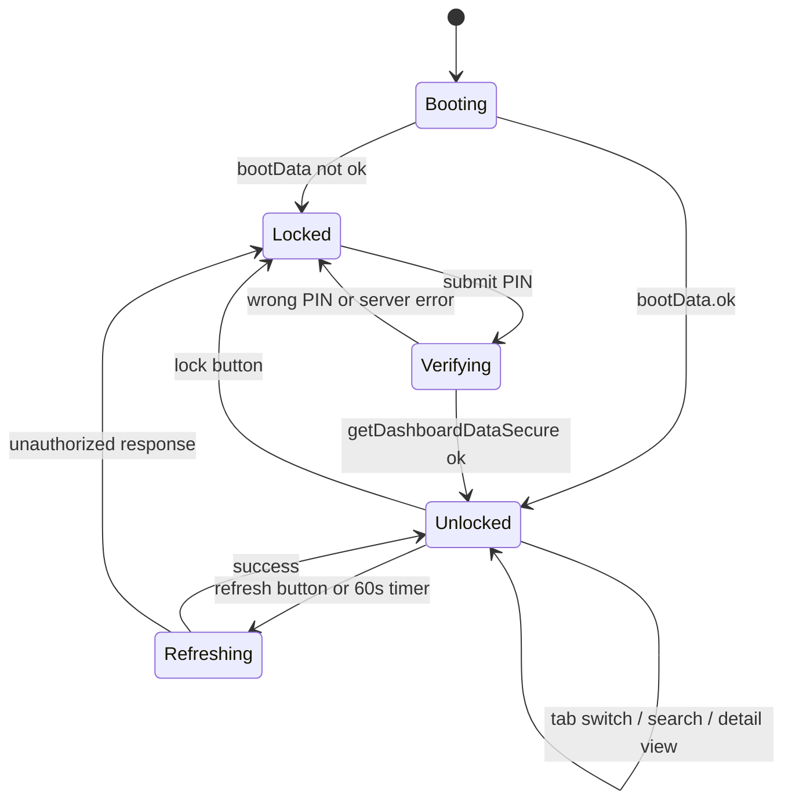

**Lifecycle details**

- `boot()` reads `#bootData` JSON. If `ok`, it calls `showApp()`; otherwise it shows the lock screen.
- `showApp()` renders everything, starts a 60s auto-refresh, and strips `pin`/`key` from the URL.
- `refreshData(silent)` is skipped while `state.busy`; it disables the refresh button.
- Auto-refresh only runs when `document.visibilityState === 'visible'`.
- An auth error during refresh triggers `lock()`.
- `lock()` clears data, closes detail views, stops the timer, and shows the lock screen.
- All rendering uses `esc()` for user data; `renderAnswer()` escapes first, then linkifies URLs.

---

## 20. Security layers and trust boundaries

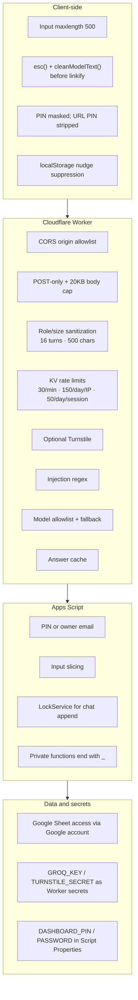

**Controls that exist**

- Origin allowlist in the Worker (`ALLOWED_ORIGINS`).
- Per-IP and per-session KV throttles.
- Request size cap (20KB) and per-message cap (500 chars).
- Role whitelist for messages (`user`/`assistant` only).
- Prompt-injection regex on the last user message.
- Optional Cloudflare Turnstile verification.
- Model allowlist/filter and fallback chain.
- Dashboard PIN/owner-email gate; data API only through `getDashboardDataSecure`.
- XSS-safe rendering in both the public chat and the dashboard.

**Controls that do not exist / caveats**

- No authentication on `doPost`: anyone with the `/exec` URL can append rows or trigger emails. The Worker uses the same URL.
- CORS is not authentication: missing/`null` Origin is allowed.
- The injection regex only inspects the last user message, not earlier turns or the client-supplied `digest`.
- The `digest` is inserted into the system prompt as "trusted" context, but it is built client-side and can be forged.
- KV counters use read-modify-write, are eventually consistent, and fail open.
- The Worker answer cache is per isolate and keyed by `question + '#' + messages.length`, not by full context.
- Turnstile is currently disabled because `TURNSTILE_SECRET` is not set; the client does not send a token.
- `.turnstile.json` is gitignored, but it contains a live-looking secret; if it was ever committed or shared, rotate it.

---

## 21. State and storage lifecycle

```mermaid
flowchart LR
  subgraph BROWSER["Browser — per tab/session"]
    H["sessionStorage<br/>alnazeer_chat_hist<br/>last 60 messages"]
    V["sessionStorage<br/>alnazeer_chat_view<br/>last 40 bubbles"]
    S["sessionStorage<br/>alnazeer_chat_session<br/>c-..."]
    T["localStorage<br/>alnazeer_ai_tip_closed<br/>timestamp"]
  end

  subgraph WORKER["Worker isolate — ephemeral"]
    M["globalThis.CHAT_MODELS"]
    AC["globalThis.ANSWER_CACHE<br/>max 60 · TTL 10 min"]
  end

  subgraph KV["Cloudflare KV"]
    K1["m:IP · 120s"]
    K2["d:IP:day · ~25h"]
    K3["s:session:day · ~25h"]
  end

  subgraph SHEET["Google Sheet — durable"]
    SH1["استشارات"]
    SH2["تواصل"]
    SH3["محادثات AI"]
  end

  H --> S
  V --> S
  S --> WORKER
  WORKER --> K1
  WORKER --> K2
  WORKER --> K3
  WORKER --> SH3
  WORKER --> SH1
  SHEET --> DASH["Dashboard reads"]
```

| State | Lifetime | Cleared by |
|---|---|---|
| `alnazeer_chat_hist` | Tab session | Tab close, clear button |
| `alnazeer_chat_view` | Tab session | Tab close, clear button |
| `alnazeer_chat_session` | Tab session | Tab close |
| `alnazeer_ai_tip_closed` | Persistent | User/browser data clear; suppresses nudge for 120s |
| `CHAT_MODELS` | Worker isolate | Isolate eviction/redeploy |
| `ANSWER_CACHE` | Worker isolate, 10 min TTL | Isolate eviction; max 60 entries |
| KV counters | 120s / ~25h | TTL |
| Sheet rows | Permanent | Manual deletion |
| Dashboard `bootData` | Page load | Refresh/reload |

**Important:** `sessionStorage` is per tab. Opening the chat in a second tab creates a new session ID and a separate history, even for the same visitor. The dashboard will show them as separate conversations.

---

## 22. Failure modes and fallbacks

| Failure | Handled where | User sees |
|---|---|---|
| `AI_WORKER_URL` empty | `script.js` `send()` | Offline message + free-session link |
| Worker network error | `script.js` `.catch()` | "تعذر الاتصال..." + booking/WhatsApp |
| Worker 429 (rate limit) | Worker `abuseGuard` | `BUSY_MSG` with WhatsApp |
| All models fail with 429 | Worker fallback | Busy message with WhatsApp |
| All models fail otherwise | Worker fallback | Longest partial or `FALLBACK` |
| Model answer cut by `max_tokens` | Worker loop | Next model; longest partial if all cut |
| In-chat booking Sheet failure | Worker 8s timeout | Technical-error message + WhatsApp |
| Apps Script email failure | `Code.gs` try/catch | Row saved; `emailed:false`; dashboard still shows it |
| KV failure | `abuseGuard` catch | Request allowed (fail open) |
| Turnstile network failure | `verifyTurnstile` catch | Request allowed (fail open) |
| Dashboard wrong PIN | `getDashboardDataSecure` | Error text on lock screen |
| Dashboard server error | `buildDashboardData_` catch | `{ok:false,error}` on lock screen |
| Dashboard refresh unauthorized | `Index.html` | `lock()` |
| Chat JSON parse error | Worker | Treated as empty messages → 400/fallback |
| Booking form server failure | `script.js` no-cors | Still shows success (cannot detect) |

---

## 23. Key configuration constants

| Constant | Location | Value / meaning |
|---|---|---|
| `AI_WORKER_URL` | `script.js` | Deployed Worker URL; hardcoded |
| `GOOGLE_FORM_CONFIG.actionUrl` | `script.js` | Apps Script `/exec` URL; hardcoded |
| `SHEET_URL` | `worker/worker.js` | Same Apps Script `/exec` URL; hardcoded |
| `SHEET_ID` | `appscript/Code.gs` | Target spreadsheet ID |
| `NOTIFY_EMAIL` | `appscript/Code.gs` | Owner notification address |
| `CHAT_TAB` | `appscript/Code.gs` | `محادثات AI` |
| `CHAT_HEADERS` | `appscript/Code.gs` | الوقت، المحادثة، السؤال، الرد، الصفحة |
| `MAX_MESSAGES` | `worker/worker.js` | 16 literal turns sent to the model |
| `MAX_CONTENT` | `worker/worker.js` | 500 chars per message |
| `MAX_DIGEST` | `worker/worker.js` | 2200 chars of older-context digest |
| `RATE_LIMIT_MAX` | `worker/worker.js` | 30 requests/min/IP |
| `IP_DAILY_MAX` | `worker/worker.js` | 150 requests/day/IP |
| `SESSION_DAILY_MAX` | `worker/worker.js` | 50 messages/day/session |
| `MAX_HIST` | `script.js` | 60 messages kept in browser |
| `SEND_WINDOW` | `script.js` | 16 messages sent verbatim |
| `DIGEST_CAP` | `script.js` | 2200 chars of digest (head + tail kept) |
| `MAX_CHAT_ROWS` | `appscript/Code.gs` | 3000 rows read for dashboard |
| `MAX_APP_ROWS` | `appscript/Code.gs` | 2000 rows read for dashboard |
| `MAX_CONTACT_ROWS` | `appscript/Code.gs` | 1000 rows read for dashboard |
| `SESSION_GAP_MINUTES` | `appscript/Code.gs` | 30-minute legacy session split |
| `ONE_TAB_PER_CHAT` | `appscript/Code.gs` | `false` (all chats in one tab) |
| `EMAIL_ON_CONTACT` | `appscript/Code.gs` | `true` |

**Secrets / deployment config**

- `GROQ_KEY` — Worker secret (`npx wrangler secret put GROQ_KEY`).
- `TURNSTILE_SECRET` — optional Worker secret; when absent, Turnstile is bypassed.
- `ALLOWED_ORIGINS` — `wrangler.toml` var.
- `DASHBOARD_PIN`, `DASHBOARD_PASSWORD` — Apps Script Script Properties; code has fallbacks.
- `SHEET_ID` — `Code.gs` constant; the script must have access to that spreadsheet.

---

## 24. Notable behaviors, gaps, and gotchas

These are observations from reading the current code, not necessarily bugs. They are the things most likely to confuse someone new to the project.

1. **Service pages are orphaned from the main navigation.** `services.html` links only to `ai.html` and `build.html`. The 15 `service-*.html` pages are children of `ai-agents.html`, `custom-ai.html`, and `software.html`, but those hubs are not linked from `ai.html`, `build.html`, or `services.html`. Only service-page breadcrumbs point back to the hubs. This is a real navigation/SEO gap.

2. **Booking success is optimistic.** The website form uses `mode: 'no-cors'` and calls `showSuccess()` on both resolve and reject. It cannot tell whether Apps Script saved the row. If confirmation matters, switch to a CORS-enabled JSON endpoint or a hidden iframe/form POST with a visible fallback.

3. **`doPost` is unauthenticated.** Anyone with the `/exec` URL can append to `استشارات`/`تواصل` or trigger notification emails. The Worker protects the AI chat path, but the Apps Script endpoint itself has no shared secret or signature check. Consider a shared token in the Worker → Apps Script requests and rate limiting/validation in `doPost`.

4. **The dashboard PIN has hardcoded fallbacks.** `MASTER_PIN` and `MASTER_PASSWORD` are defined in `Code.gs` and used if Script Properties are absent. Prefer requiring Script Properties and removing the literals from source.

5. **The client-supplied `digest` is trusted by the Worker.** It is inserted into the system prompt under a "trusted visitor information" heading. A malicious client can forge it to inject instructions. The injection regex only checks the last user message, not the digest or earlier turns.

6. **The injection filter is last-message-only.** Earlier user turns can carry an injection payload that the model may still follow. Consider scanning all user turns or using a model-based guard.

7. **CORS allows missing/`null` Origin.** `originAllowed()` returns `true` for missing or `null` origins, so curl and `file://` requests pass. The allowlist is a browser-side guard, not authentication.

8. **KV rate limiting is best-effort.** `bump()` is a read-modify-write with no atomic increment. Under concurrency, counts can undercount. KV is also eventually consistent. It is a speed bump, not a hard quota.

9. **The answer cache is per isolate and shallow-keyed.** `ANSWER_CACHE` is `globalThis`, so each Worker isolate has its own cache. The key is `lastUserContent + '#' + messages.length`, so the same question at the same depth in a different context can reuse an answer for up to 10 minutes.

10. **In-chat booking is powerful but delicate.** The model must emit exact Arabic JSON keys. If it emits malformed JSON, the block is removed and the user gets the remaining text. The Sheet call has an 8-second timeout. Successful bookings are not cached.

11. **Chat logs are Q/A pairs, not full transcripts.** The Worker logs only the last user question and the final answer, plus session/page. The dashboard reconstructs conversations by session label and timestamp. The digest is not logged.

12. **Dashboard reads are capped and unpaginated.** `MAX_CHAT_ROWS`/`MAX_APP_ROWS`/`MAX_CONTACT_ROWS` bound the payload, but older rows are invisible. A large sheet can also hit Apps Script execution-time limits.

13. **The dashboard embeds the full dataset in the initial HTML.** `initialData` is serialized into `#bootData`, so the first paint waits for all sheet reads. For large datasets, consider lazy loading per tab.

14. **`isOwner_()` may be empty for anonymous web-app users.** The web app executes as the deploying user (`executeAs: USER_DEPLOYING`), so `Session.getActiveUser()` can be blank for visitors. PIN auth is the practical path.

15. **`waLink()` normalization is heuristic.** It handles 9-digit Sudan numbers, 10-digit Saudi `05...` numbers, and generic `0...` numbers. Other country formats may be mis-normalized.

16. **`readChatRows_()` skips any question containing `بداية محادثة`.** That phrase was an old separator marker, but a legitimate visitor question containing it would also be skipped.

17. **`ensureChatSheet_()` archives and deletes the old tab.** If the archive write fails, the catch returns the old sheet; if it succeeds, the old tab is deleted. Back up the sheet before changing `CHAT_HEADERS`.

18. **Hardcoded deployment URLs are duplicated.** The Worker URL and Apps Script URL appear in `script.js`; the Apps Script URL also appears in `worker.js`; the Worker name and KV ID appear in `wrangler.toml`. A deployment change is a multi-file edit.

19. **The chat UI is injected into every page.** `script.js` creates the drawer header, overlay, clear button, close button, and nudge dynamically. If a page is missing `#chatFab` or `#chatPop`, those features silently do nothing.

20. **`sessionStorage` is per tab.** A visitor who opens a second tab gets a new chat session. The dashboard will show two sessions even though it is the same person.

---

## 25. Suggested reading paths

**If you have 10 minutes**

1. §2 System context
2. §9 AI assistant end-to-end sequence
3. §14 `doPost` routing
4. §16 Data model
5. §24 Gotchas

**If you are changing the AI assistant**

1. §6 Frontend runtime
2. §7 Chat popup state machine
3. §9 End-to-end sequence
4. §10 Worker pipeline
5. §11 Model fallback
6. §12 In-chat booking

**If you are changing bookings or the dashboard**

1. §8 Website booking flow
2. §13 Apps Script backend map
3. §14 `doPost` routing
4. §15 Dashboard auth/refresh
5. §16 Data model
6. §17 Session grouping
7. §18 Dashboard UI map
8. §19 Dashboard state machine

**If you are hardening the system**

1. §20 Security layers
2. §21 Storage lifecycle
3. §22 Failure modes
4. §24 Gotchas (especially items 3, 4, 5, 7, 8)

---

*Generated from the current working tree. If you change routes, sheet headers, or deployment URLs, update the diagrams alongside the code.*
